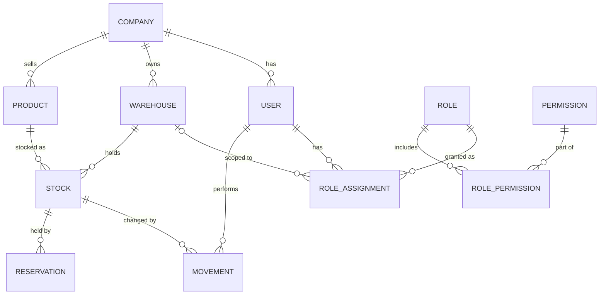

# BodeGo - Spec

## Problem

Small businesses with one or more warehouses can't
tell how much stock they have of each product or
where it is. They promise items they don't have,
take too long to confirm availability and lose
customers.

## Goals

- A seller can answer "Do we have it, how
  many and where?" in under a second.
- Every stock change is traceable to a user,
  a date and a reason.
- Stock never goes negative, even with
  simultaneous outbound movements.
- A new company can set up its first warehouse
  and products in under 10 minutes.

## Outside MVP

- Invoicing, purchasing from suppliers, accounting.
- Lots, serial numbers and expiration dates.
- Native mobile apps.
- Barcode scanner hardware.

## Users and roles

A user can hold several roles at once. Each role
assignment is scoped either to one warehouse or
to the whole company. A user's permissions are
the union of all their assignments, the code
always checks permissions
never role names.

| Permission           | Description                             | Admin | Warehouse clerk | Seller |
| -------------------- | --------------------------------------- | ----- | --------------- | ------ |
| `user:manage`        | Manage users and role assignments.      | yes   | no              | no     |
| `warehouse:manage`   | Create and edit warehouses              | yes   | no              | no     |
| `product:manage`     | Create and edit products                | yes   | no              | no     |
| `movement:create`    | Register inbound, outbound, adjustments | yes   | yes             | no     |
| `transfer:manage`    | Create and receive transfers            | yes   | yes             | no     |
| `stock:read`         | Check availability                      | yes   | yes             | yes    |
| `reservation:create` | Reserve stock for an order              | yes   | no              | yes    |
| `adjustment:approve` | Approve adjustments above the threshold | yes   | no              | no     |
| `audit:read`         | View the audit log                      | yes   | no              | no     |

## Domain model

- **Stock:** on-hand quantity of one product in
  one warehouse.
- **Movement:** an immutable record that changes
  stock (inbound, outbound, adjustment, transfer).
- **Reservation:** quantity held for a pending
  order. It lowers available stock, not on-hand
  stock.
- **Role assignment:** user + role + warehouse.
  An empty warehouse means the whole company.

## Business rules

- **BR-01** On-hand stock can never be negative.
  An outbound movement larger than available stock
  is rejected.
- **BR-02** Movements are immutable. A mistake is fixed
  with a reversing movement that references the original.
- **BR-03** Available = on-hand − reserved.
- **BR-04** A transfer creates an outbound movement
  at the source when sent and an inbound movement at
  the destination when received.
  Units in transit count in neither warehouse.
- **BR-05** Adjustments require a reason: damage,
  loss or count correction.
- **BR-06** A reservation expires after 24 h if
  the order isn't dispatched.
- **BR-07** Users only see data from their own company.
- **BR-08** Adjustments above a configurable value stay
  pending until a user with `adjustment:approve`
  approves them. Nobody can approve their own
  adjustment.
- **BR-09** Permissions are checked against the warehouse
  involved: a permission granted in one warehouse
  does not apply in another.
